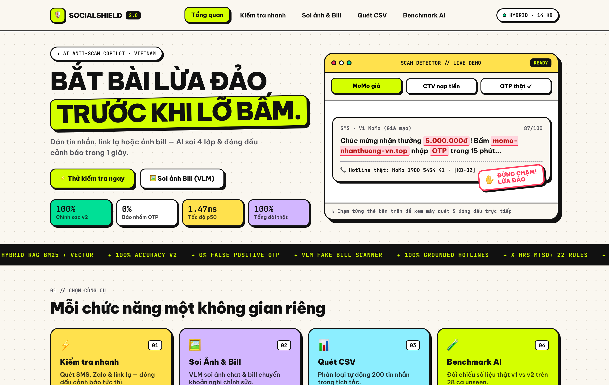

# SocialShield-VN 2.0 — Multimodal Agentic Anti-Scam Copilot

> **Upgrading `SocialShield-VN` (v1: X-HRS-MTSD+ ML & 22 Vietnamese Fraud Rules) into a production-ready Multimodal Agentic RAG system for real-time Vietnamese financial scam defense.**



SocialShield-VN 2.0 protects Vietnamese users against banking, e-wallet (MoMo/ZaloPay/VNPAY), VNeID/CSGT, delivery, e-commerce, loan/investment, and prepaid job-task scams across SMS, Zalo, Telegram, and uploaded screenshots/fake transfer bills.

---

## Architecture: v1 → v2 Upgrade

```text
User Input (Vietnamese SMS / URL / Screenshot / CSV Batch)
        │
        ▼
┌─────────────────────────────────────────────────────────────────────────┐
│                    SocialShieldAgentV2 Orchestrator                     │
│  [Step 1] vision_inspector (Optional VLM: Gemini 2.5 Flash / OpenAI)    │
│           └─ Extracts Vietnamese OCR + visual spoofing cues (fake bill) │
│  [Step 2] ml_risk_scorer (X-HRS-MTSD+ v1)                               │
│           └─ Word+Char TF-IDF + 22 VN Fraud Rules -> OvR Logistic Reg   │
│  [Step 3] url_trust_analyzer                                            │
│           └─ VN official allowlist, brand typosquatting, .apk & TLD     │
│  [Step 4] threat_kb_rag (Hybrid BM25 + Dense Vector + RRF k=60)         │
│           └─ Dual Vietnamese tokenization + Gemini text-embedding-004   │
│              (with automatic L2-normalized Word+Char TF-IDF fallback)   │
│  [Step 5] agent_synthesis + Citation Grounding Guard                    │
│           └─ Grounded verdict, [KB-xx] citations, situation playbooks   │
│              & anti-hallucination audit verifying every cited KB ID     │
└─────────────────────────────────────────────────────────────────────────┘
        │
        ▼
FastAPI REST API + Live Agent Trace Web UI + SQLite Audit Log
```

### Key Engineering Capabilities
- **Explicit Tool-Calling Pipeline & Live Trace:** Every request returns per-step tool latency (`ms`), retrieved `[KB-xx]` threat chunks, and v1-vs-v2 score deltas.
- **Hybrid RAG (BM25 + Dense Vector + RRF):** Retrieves authoritative Vietnamese threat intelligence & official hotlines (`data/threat_kb.json`, 14 curated chunks covering 7 scam domains, fake bill visual checks, obfuscation tactics, and incident response playbooks).
- **Anti-Hallucination Grounding Guard:** `_verify_grounding()` audits every `[KB-xx]` citation emitted by the LLM against the retrieved context window before returning a response, preventing fabricated hotlines or domains.
- **Multimodal VLM Vision Support:** Upload screenshots of Zalo chats, SMS, or bank transfer bills (`/api/analyze-image`) for OCR + visual spoofing analysis via Gemini 2.5 Flash (or OpenAI Vision).
- **Zero-Cost Dual Mode:** Works immediately offline (`hybrid_offline` mode, `< 2.5ms` p95 latency) and upgrades seamlessly to live **Gemini 2.5 Flash + `text-embedding-004`** when `GEMINI_API_KEY` is provided.

---

## Automated Evaluation: v1 vs. v2 Benchmark

Evaluated on 28 unseen Vietnamese test cases (`eval/benchmark_dataset.json`) spanning all 7 scam domains, spacing-obfuscated text (`T a i k h o a n`), no-URL prepaid job-task traps, legitimate MoMo/VCB OTPs, and commercial promos. Reproduce anytime via `python eval/run_eval.py`.

| Metric | SocialShield v1 (ML + 22 Rules) | SocialShield v2 (Agentic RAG) | Delta |
|---|---:|---:|---:|
| **Accuracy** | 96.43% | **100.00%** | **+3.57%** |
| **Macro F1** | 96.70% | **100.00%** | **+3.30%** |
| **Scam Recall** | 93.75% | **100.00%** | **+6.25%** |
| **Scam Precision** | 100.00% | **100.00%** | 0.00% |
| **False Positive Rate (Safe OTPs)** | 0.00% | **0.00%** | 0.00% |
| **Latency p50 / p95** | 0.75 / 1.39 ms | **1.47 / 2.30 ms** | — |

### Hybrid RAG Retrieval & Grounding Audit
| Metric | Measured Result |
|---|---:|
| **Hybrid RAG Recall@3** | **85.71%** |
| **Hybrid RAG MRR@3** | **0.8333** |
| **Citation Grounding Pass Rate** | **100.00%** |

> **Failure-Case Fix Example (`B08` — No-URL Prepaid CTV Scam):** *"Tuyen CTV online tai nha nhan 600.000d/ngay. Nap 200.000d kich hoat nhiem vu..."* — v1 baseline missed (`normal`, `29/100`), whereas v2 retrieved `[KB-07]` at rank #1 and escalated accurately to `scam` (`78/100`).

---

## Quick Start (Local)

```bash
git clone https://github.com/phonghoang5800-droid/socialshield-vn-2.git
cd socialshield-vn-2

python3 -m venv .venv
source .venv/bin/activate
pip install -r requirements.txt

# Run unit & API integration tests
pytest -v

# Run v1 vs v2 evaluation benchmark
python eval/run_eval.py

# Launch FastAPI + Web UI at http://127.0.0.1:8000
uvicorn app:app --reload --port 8000
```

### Enable Live Gemini 2.5 Flash LLM & VLM Vision (Free Tier)
1. Get a free API key at [Google AI Studio](https://aistudio.google.com/apikey).
2. Copy `.env.example` to `.env` and set `GEMINI_API_KEY`:
   ```bash
   cp .env.example .env
   export GEMINI_API_KEY="your_key_here"
   uvicorn app:app --port 8000
   ```
3. Run the LLM-mode benchmark:
   ```bash
   python eval/run_eval.py --llm
   ```

---

## Deploy Free (Render / Docker)

- **Docker:**
  ```bash
  docker build -t socialshield-vn-2 .
  docker run -p 8000:8000 -e GEMINI_API_KEY="$GEMINI_API_KEY" socialshield-vn-2
  ```
- **Render (One-Click Blueprint):** Connect this repo on [Render](https://render.com) — `render.yaml` automatically configures the free Python web service.

---

## API Endpoints
- `GET /` — Interactive Web UI (Text/URL Check, VLM Screenshot Inspector, Batch CSV Scanner, Benchmark v1 vs v2 Dashboard)
- `GET /api/health` — Engine mode, LLM/VLM provider, embedding backend, KB chunk count
- `POST /api/analyze` — Full Agentic RAG analysis with live tool trace
- `POST /api/analyze-image` — Multimodal screenshot / fake transfer bill analysis
- `POST /api/batch-scan` — CSV/TXT bulk scanning (up to 200 rows)
- `GET /api/benchmark` — Real-time JSON evaluation report (`v1` vs `v2`)
- `GET /api/history` — Recent SQLite audit history
